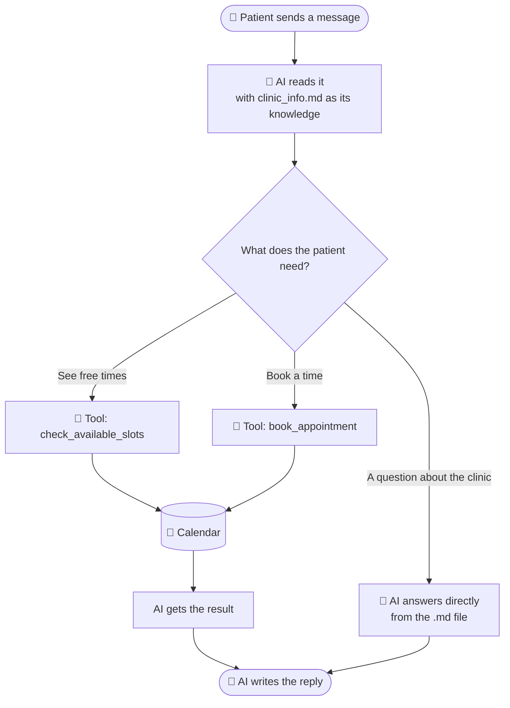

<div align="center">

# 🏥 Clinic AI Receptionist

### A friendly chatbot that answers patient questions and books appointments — 24/7.

<br>


**💬 Chat in your browser  •  ⌨️ Chat in your terminal  •  📅 Real calendar bookings**

</div>

---

## 📖 Table of contents

- [What is this?](#-what-is-this)
- [See it in action](#-see-it-in-action)
- [Features](#-features)
- [How it works](#-how-it-works)
- [Quick start (5 minutes)](#-quick-start-5-minutes)
- [Choose your AI provider](#-choose-your-ai-provider)
- [Connect Google Calendar](#-connect-google-calendar-optional)
- [Make it your own clinic](#-make-it-your-own-clinic)
- [Settings reference](#%EF%B8%8F-settings-reference)
- [Project structure](#-project-structure)
- [Troubleshooting](#-troubleshooting)
- [Safety and privacy](#-safety-and-privacy)
- [Ideas for next steps](#-ideas-for-next-steps)

---

## 🌟 What is this?

Think of it as a **digital front-desk worker** for a clinic. Patients can chat with it to:

1. **Ask questions** — "When are you open?", "How much is a check-up?", "Is there parking?"
2. **Book a visit** — it checks the calendar, shows free times, and books the one the patient picks.

You give it a simple text file about your clinic. It does the rest.

> 🧒 **No Google account? No problem.** The project starts in **Demo Mode**, which saves bookings in a small local file. You can try the whole thing in minutes, then switch to real Google Calendar when you are ready.

---

## 🎬 See it in action

```text
You:  Hi! What time do you close on Saturday?
Bot:  We're open Monday to Saturday, 9:00 AM to 5:00 PM. The last appointment starts at 4:30 PM.

You:  Great, can I see Dr. Rahman tomorrow afternoon?
Bot:  Sure! Tomorrow (Monday) I have 1:00 PM, 1:30 PM, 3:00 PM and 4:30 PM free.
      Which one works for you, and what's your full name?

You:  3 PM please, I'm Ayesha Khan
Bot:  Just to confirm: Ayesha Khan, Monday 19 October at 3:00 PM. Shall I book it?

You:  Yes
Bot:  All done! ✅ You're booked for Monday at 3:00 PM. Please arrive 10 minutes early.
```

---

## ✨ Features

| | Feature | What it means for you |
|---|---|---|
| 📚 | **FAQ from a text file** | Edit `data/clinic_info.md` — no coding needed. Changes show up instantly. |
| 📅 | **Smart booking** | The AI checks free slots first, so it never double-books. |
| 🧠 | **Function calling** | The AI itself decides: *answer a question* or *use the calendar*. |
| 🔌 | **Works with many AIs** | OpenAI, Groq, LM Studio, Ollama — change two lines in `.env`. |
| 🖥️ | **Pretty web chat** | Light and dark mode, phone friendly, quick-question buttons. |
| ⌨️ | **Terminal chat** | Great for quick testing in VS Code. |
| 🧪 | **Demo mode** | Test everything without Google setup. |
| 🛡️ | **Safe by design** | No medical advice, secrets stay out of Git, input is validated. |

---

## 🧩 How it works

Here is the journey of one message:



**In plain words:**

1. The AI always has your clinic's info and today's date in front of it.
2. For a simple question, it just answers.
3. For anything about appointments, it asks our code to look at (or write to) the calendar. This is called **function calling** (or "tool calling").
4. It reads the result and replies in a friendly way.

The AI **must** check the calendar before suggesting times, and **must** get a clear "yes" from the patient before booking.

---

## 🚀 Quick start (5 minutes)

### 1. Get the code and open the folder

```bash
cd clinic_receptionist_bot
```

### 2. Create a virtual environment and install

<details open>
<summary><b>🪟 Windows (PowerShell)</b></summary>

```powershell
python -m venv .venv
.venv\Scripts\Activate.ps1
pip install -r requirements.txt
```
</details>

<details>
<summary><b>🍎 macOS / 🐧 Linux</b></summary>

```bash
python3 -m venv .venv
source .venv/bin/activate
pip install -r requirements.txt
```
</details>

### 3. Add your API key

Open the **`.env`** file and replace the placeholder:

```env
OPENAI_API_KEY=sk-your-real-key
```

Leave `MOCK_CALENDAR=true` for now — that is Demo Mode.

### 4. Start chatting!

**🌐 Web version (recommended)**

```bash
python server.py
```

Then open **http://localhost:8000** in your browser.

**⌨️ Terminal version**

```bash
python main.py
```

🎉 **That's it.** Try: *"What are your opening hours?"* and then *"Book me an appointment tomorrow at 10 AM."*

---

## 🤖 Choose your AI provider

The code uses the standard **OpenAI format**, so many providers work. Pick one and paste its lines into `.env`:

| Provider | `OPENAI_API_KEY` | `OPENAI_BASE_URL` | `LLM_MODEL` (example) |
|---|---|---|---|
| **OpenAI** | your `sk-...` key | *(leave empty)* | `gpt-4o-mini` |
| **Groq** ⚡ | your `gsk_...` key | `https://api.groq.com/openai/v1` | `llama-3.3-70b-versatile` |
| **LM Studio** 💻 | `lm-studio` *(anything)* | `http://localhost:1234/v1` | the model you loaded |
| **Ollama** 🦙 | `ollama` *(anything)* | `http://localhost:11434/v1` | `llama3.1` |

> ⚠️ **Tip:** the model must support **tool / function calling**. Most modern OpenAI, Groq and Llama 3.1+ models do. Very small local models may struggle with booking.

---

## 📅 Connect Google Calendar (optional)

Skip this section while testing in Demo Mode. When you want **real** bookings:

1. Go to the [Google Cloud Console](https://console.cloud.google.com/) and **create a project**.
2. Open **APIs & Services → Library**, search **Google Calendar API**, click **Enable**.
3. Open **APIs & Services → OAuth consent screen**.
   Choose **External**, fill the app name and your email, then under **Test users** **add your own Google email**.
4. Open **APIs & Services → Credentials → Create credentials → OAuth client ID**.
   Choose **Desktop app**, then **Download JSON**.
5. Rename the file to **`credentials.json`** and put it in the project root (next to `main.py`).
6. In `.env`, set:
   ```env
   MOCK_CALENDAR=false
   CLINIC_TIMEZONE=Asia/Karachi   # use your own timezone
   ```
7. Run `python server.py` (or `python main.py`) and send a booking request.
   **A browser tab opens once** asking you to sign in and allow calendar access.
   A `token.json` file is then saved, so you won't be asked again.

✅ Booked appointments now appear in your Google Calendar as **"Appointment: Patient Name"**.

> 💡 Want a separate calendar just for the clinic? Create one in Google Calendar, copy its **Calendar ID** (Settings → *Integrate calendar*), and set `GOOGLE_CALENDAR_ID` in `.env`.

---

## 🏠 Make it your own clinic

### Change the clinic info
Open **`data/clinic_info.md`** and edit it like a normal document. Use `##` headings to organize sections. The bot reads the file fresh on every question — **no restart needed**.

### Change the schedule
In `.env`:

```env
CLINIC_OPEN=08:00
CLINIC_CLOSE=18:00
SLOT_MINUTES=20
WORKING_DAYS=0,1,2,3,4      # Monday to Friday  (Monday=0 ... Sunday=6)
```

> 📝 Keep the hours in `clinic_info.md` the same as in `.env`, so the bot never says two different things.

### Change the look of the web page
- Colors and fonts: top of `frontend/style.css` (the `:root` section).
- Clinic name, address and hours board: `frontend/index.html`.
- Quick-question buttons: `QUICK_QUESTIONS` in `frontend/app.js`.

---

## ⚙️ Settings reference

All settings live in `.env`.

| Setting | Default | What it does |
|---|---|---|
| `OPENAI_API_KEY` | — | Your AI provider key |
| `OPENAI_BASE_URL` | *(empty)* | Set for Groq, LM Studio, Ollama |
| `LLM_MODEL` | `gpt-4o-mini` | Which AI model to use |
| `MOCK_CALENDAR` | `true` | `true` = demo file, `false` = Google Calendar |
| `GOOGLE_CALENDAR_ID` | `primary` | Which calendar receives bookings |
| `GOOGLE_CREDENTIALS_FILE` | `credentials.json` | Google OAuth file |
| `GOOGLE_TOKEN_FILE` | `token.json` | Saved sign-in (auto-created) |
| `CLINIC_TIMEZONE` | `UTC` | Example: `Asia/Karachi`, `America/New_York` |
| `CLINIC_OPEN` / `CLINIC_CLOSE` | `09:00` / `17:00` | Bookable hours |
| `SLOT_MINUTES` | `30` | Length of each appointment |
| `WORKING_DAYS` | `0,1,2,3,4,5` | Monday=0 … Sunday=6 |
| `MAX_DAYS_AHEAD` | `60` | How far ahead patients can book |
| `HOST` / `PORT` | `127.0.0.1` / `8000` | Web server address |

---

## 🗂️ Project structure

```text
clinic_receptionist_bot/
│
├── 📂 data/
│   └── clinic_info.md        ← 📝 Your clinic's facts. Edit me!
│
├── 📂 src/
│   ├── __init__.py
│   ├── faq_handler.py        ← 📚 Reads the .md file and finds the right info
│   ├── calendar_agent.py     ← 📅 Checks free slots and books (Google or demo)
│   └── bot_engine.py         ← 🧠 The brain: AI + function calling
│
├── 📂 frontend/              ← 🎨 The web chat page
│   ├── index.html
│   ├── style.css
│   └── app.js
│
├── main.py                   ← ⌨️  Terminal chat
├── server.py                 ← 🌐 Web chat server
├── requirements.txt          ← 📦 Python packages
├── .env                      ← 🔑 Your keys and settings (private!)
├── .env.example              ← 📋 Safe template to share
└── .gitignore                ← 🙈 Keeps secrets out of Git
```

**Where should I start reading the code?** Open **`src/bot_engine.py`** first. It has a diagram at the top and comments on every step.

---

## 🛠️ Troubleshooting

<details>
<summary><b>"OPENAI_API_KEY is missing"</b></summary>

Open `.env`, paste your key after `OPENAI_API_KEY=`, save the file, and restart.
</details>

<details>
<summary><b>The web page says "The assistant is unavailable right now"</b></summary>

The server could not reach the AI. Check your key, your internet, and (for LM Studio or Ollama) that the local server is running. The terminal running `server.py` shows the exact error.
</details>

<details>
<summary><b>The bot answers but never books</b></summary>

Your model may not support tool calling. Try `gpt-4o-mini` or `llama-3.3-70b-versatile`.
</details>

<details>
<summary><b>Google says "Access blocked: app not verified"</b></summary>

In the OAuth consent screen, add your email under **Test users**, then try again.
</details>

<details>
<summary><b>Google sign-in stopped working after about a week</b></summary>

Apps in "Testing" mode expire tokens after 7 days. Delete `token.json` and sign in again.
</details>

<details>
<summary><b>"No time zone found with key ..." (Windows)</b></summary>

Run `pip install tzdata`, and check the name is a real timezone such as `Asia/Karachi`.
</details>

<details>
<summary><b>I want to clear my demo bookings</b></summary>

Delete `data/mock_bookings.json`.
</details>

---

## 🔒 Safety and privacy

- 🔑 **Never share `.env`, `credentials.json` or `token.json`.** The `.gitignore` already blocks them from Git.
- 🩺 The bot is told **not to give medical advice** and to point emergencies to the emergency line.
- 📏 Messages are length-limited and validated before reaching the AI.
- 🔐 Chats are kept **in memory only** and are lost when the server restarts.
- ⚠️ **Before going public:** put the server behind HTTPS, add rate limiting, and ask patients for consent before storing personal data. Appointments contain names, which may be covered by health-privacy laws in your country.

---

## 💡 Ideas for next steps

- [ ] Cancel and reschedule appointments (new tools in `calendar_agent.py`)
- [ ] Ask for a phone number and send an SMS or email reminder
- [ ] One calendar per doctor
- [ ] Save chat history in a database
- [ ] Add a WhatsApp or Telegram connection
- [ ] Add automated tests

---

<div align="center">

**Made with ❤️ to give clinic staff more time for patients.**

⭐ If this helped you, give the repo a star!

</div>
